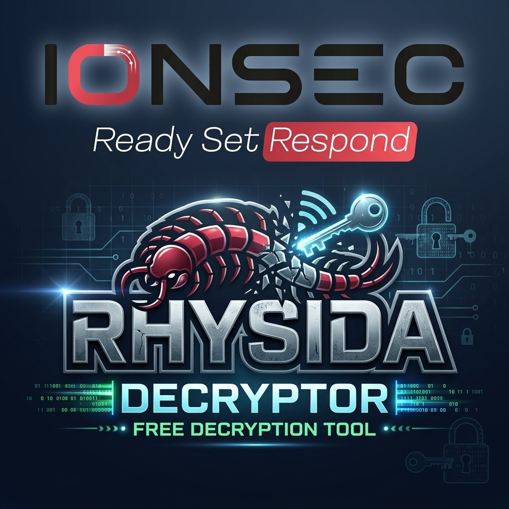

<p align="center">
  
</p>

# INSITO

INSITO is a single-file C tool that recovers files encrypted by the Rhysida
ransomware locker on ESXi and Linux x86-64, without the attacker's private
key and without a copy of the locker. Recovery is driven entirely by the
encrypted files themselves: their trailers identify the key material, their
mtimes bound the clock search, and the locker's weak PRNG makes every per-file
key reproducible once the encryption clock is known. It exists so victims and
responders can restore data on systems they own or are authorized to
remediate.

Downloads: https://github.com/ionsec/insito/releases/tag/v1.0.0 - Project site: https://ionsec.io/resources/insito-rhysida-esxi-recovery

Public release: CyberWeek 2026 — Monday, 9 November 2026. The repository and
the release binary go public then; until then both stay private.

## Threat context

Rhysida is a Windows/ESXi ransomware family whose ESXi locker (the ELF
variant, internally versioned "Rhysida-0.1") encrypts VMware datastores in
place with AES-256-CTR and appends a 0x40C-byte trailer to every file:
RSA-4096-OAEP-wrapped per-file AES key and IV. Per-file key material is drawn
from a ChaCha20 stream whose entropy comes from glibc `rand()`, which is in
turn seeded from the wall clock (`srand((uint)time(NULL))`). That stream is
fully reproducible once the seed clock is known, so recovery never needs the
attacker's private key or a sample of the locker.

## What INSITO does

- Scans the target datastore recursively for `*.rhysida` files.
- Derives the clock candidate window from file mtimes.
- Runs a blind sweep: replays the locker's PRNG stream per candidate clock and
  matches the RSA-OAEP trailer stored in each file (no plaintext needed).
- Restores matched files with AES-256-CTR; encrypted inputs are never modified.
- Writes report files with the recovered clock and file results (SHA-256 of
  each restored file is printed at run time).

## Quick start

```console
# 1. scan (read-only preview; writes nothing, changes nothing)
./insito --scan /vmfs/volumes/datastore1

# 2. recover
./insito --datastore /vmfs/volumes/datastore1

#    unattended / scripted
./insito --datastore /vmfs/volumes/datastore1 --accept-license --yes
```

The first run requires license acceptance: read the terms with `--license`
and accept once at the `accept` prompt, or pass `--accept-license`
non-interactively. Acceptance is recorded once as a validated JSON consent
record (`~/.config/insito/acceptance.json`, 0600, versioned - re-prompting
only on a license-version bump) and later runs stay silent. Without it,
INSITO refuses to run (exit code 2, no files touched).

Restored copies land in `<datastore>/rhysida_recovered/` together with the
recovery report (text + JSON). A wider clock search is available with
`--window <seconds>` (default 600, range 30-86400); for builds with rotated
campaign keys, `--key <carrier file>` carves the matching public key - pass
the locker binary (.elf), a PEM block (ransom note) or a raw
modulus+exponent pair, all three are accepted. `./insito --help` lists
everything.

**Before moving encrypted files around, read the next section - speed
depends almost entirely on how the files get to the decryptor.**

## Recovery speed & constraints (read before you copy files)

INSITO is fastest on the **system where the ransomware actually ran**, and
slower for every step you take offline. That is a hard constraint of the
attack, not of the tool: the sweep anchors on file mtimes (and, when you
provide it, the victim's clock). The closer those two signals are to truth,
the smaller the search. Plan your recovery like this:

| Tier | Scenario | Speed | What you do |
| --- | --- | --- | --- |
| 0 | run INSITO on the live ESXi host / datastore | **fastest** (minutes) | nothing to configure - mtimes and clock are true where you stand |
| 1 | copy encrypted files to an offline box, **timestamps preserved** | same as tier 0 | copy with timestamp preservation, run normally |
| 2 | copy lost timestamps, **but you know when the incident hit** | near tier 0 (minutes) | read the victim's clock once, pass `--clock <epoch>` |
| 3 | no timestamps, no clock knowledge | compute-bound (long) | automatic offline sweep; bound it with `--lookback` |

**Tier 0 - live system (fastest).** Mount the datastore read-only if
possible and run against it. The clock, mtimes and data coexist, so the
window is tight and every file is checked in a single short sweep.

**Tier 1 - offline, timestamps preserved.** Plain `cp` and `scp` reset
modification times and destroy your speed anchor. Preserve them:

```console
# from the victim side (ESXi shell has rsync only if installed - tar always exists)
cd /vmfs/volumes/datastore1 && tar cpzf /tmp/enc.tgz *.rhysida

# or, host to host:
rsync -aH user@victim:/vmfs/volumes/datastore1/recovery/ /lab/enc/
scp -p user@victim:/vmfs/volumes/datastore1/*.rhysida /lab/enc/
```

Then run INSITO normally - it derives the same tight window it would have
had on the live system.

**Tier 2 - offline, timestamps lost, incident time known.** The single most
useful thing to carry away from a victim machine is its clock:

```console
# on the victim ESXi host (BusyBox date is epoch-capable):
date +%s
#   -> 1793982603

# then, on the offline decryption box:
./insito --datastore /lab/enc --clock 1793982603 --accept-license --yes
```

`date` prints the current clock, not the detonation time - but for a
recent incident the difference is small, and `--window` absorbs it (default
600 s, widen up to 86400 with `--window`, e.g. a host that sat idle for a
day between encryption and imaging). Other good clock anchors: vmkernel /
hostd log timestamps on the victim, your IR timeline, or the ransom note's
drop time. With a true anchor, an offline run approaches tier-0 speed.

**Tier 3 - nothing known.** Give the decryptor the biggest box you can
spare: on a clean miss INSITO automatically escalates into a hardware-
scaled offline search (every core, capped by available memory; live
progress + ETA). Windows of a few hours are minutes of compute; days are
hours; the default 30-day lookback is a heavy compute - bound it whenever
part of the incident window is known:

```console
./insito --datastore /lab/enc --lookback 7      # incident was this week
```

`--threads <n>` caps workers manually if you must share the box.

**Constraint recap:** mtime resets are the #1 self-inflicted slowdown -
copy with `tar`/`rsync -a`/`scp -p`, or carry one `date +%s` reading back
with you.

## Credits

INSITO extends to the ESXi/Linux build of Rhysida a recovery technique
established for the Windows builds by:

- G. Kim, S. Kang, S. Baek, K. Kim, J. Kim, *"A Method for Decrypting Data
  Infected with Rhysida Ransomware"*, arXiv:2402.06440 (Feb 2024),
  https://doi.org/10.48550/arXiv.2402.06440 - first successful Rhysida
  decryption; PRNG-state regeneration.
- G. Kim, S. Kang, S. Baek, K. Kim, J. Kim, *"How to decrypt files encrypted
  by Rhysida ransomware without the attacker's private key"*, Computers &
  Security, 2025,
  https://www.sciencedirect.com/science/article/abs/pii/S016740482500029X
  (journal
  version; file-order reconstruction).
- KISA, *"Rhysida ransomware cryptographic analysis report"* (Jan 2024),
  https://seed.kisa.or.kr (analysis report archive).

We are grateful for their publication of the underlying observation. The
ESXi/Linux locker differs from the Windows builds in libc, PRNG stream use
and the trailer's wrap layout, which required separate analysis and a
separate recovery engine - that is what this repository ships.

## Build from source

## Build from source

Requirements: gcc (or clang) and GNU make. LibTomCrypt and LibTomMath are
vendored under `vendor/`; nothing else is needed.

```console
make vendor   # vendored static libs: vendor/ltm_desc3.o, vendor/libtomcrypt.a, vendor/libtommath.a
make          # = make all = make static
./insito --version
```

The canonical static build command (what `make static` and CI run):

```console
gcc -O2 -s -static -Wall -Wextra -DUSE_LTM -DLTM_DESC -DESXI_KEY \
    -Ivendor/libtomcrypt/src/headers \
    -o insito insito.c vendor/ltm_desc3.o vendor/libtomcrypt.a vendor/libtommath.a
```

`-static` produces a self-contained binary; copy it to the ESXi host or a
rescue VM and run it as root against the datastore path. Run the test suite
with `make test` (synthetic, deterministic corpus only - see `tests/`).

## Safety

| Guarantee | How INSITO enforces it |
| --- | --- |
| Inputs never modified | encrypted `*.rhysida` files are opened read-only; restored copies are new files under `rhysida_recovered/` |
| Report files | every recovery run writes a text and a JSON report (clock window, hit, duration, per-file results with ciphertext SHA-256) into the restore directory |
| Confirm prompt | decryption starts only after the interactive `[y/N]` confirm; `--accept-license` (license, once) and `--yes` (prompt skip, per run) are the explicit non-interactive overrides |

## FAQ

**Do I need the encrypted sample?**
No. INSITO needs only the encrypted `*.rhysida` files themselves, with file
modification times intact. The locker binary, campaign RSA keys and plaintext
originals are never required. If a sweep finds nothing, first widen
`--window`; use `--key` only if the build actually rotated its campaign key.

**Where do reports go?**
Into the restore directory (`<datastore>/rhysida_recovered/`):
`recovery-report-<timestamp>.txt` and `.json` with the recovered clock, the
sweep result and per-file results (ciphertext SHA-256, next-step guidance).
The SHA-256 of each restored file is printed on the console during the run.
Keep the reports for insurers and IR documentation.

**The files were copied to another machine — should mtimes matter?**
Yes, by default: the sweep centers on file mtimes. Copy with
`tar`/`rsync -a`/`scp -p` to keep the original timestamps, or pass
`--clock <epoch>` after reading the clock from the victim machine
(`date +%s` on the ESXi shell). Speed tiers are detailed in
"Recovery speed & constraints" above.

**Which builds are covered?**
Static Linux x86-64 release binaries (CI-built and verified against
`SHA256SUMS`, see github.com/ionsec/insito/releases/tag/v1.0.0); they run
unchanged under ESXi (BusyBox) as well as ordinary Linux. Anything else:
build from source with the command above. The v1.0.0 release binary has
been scanned on VirusTotal; the scan is public:
https://www.virustotal.com/gui/file/fa0402e646c671478ca387c71f597a27fcf49a5cc1e0782bccc9a092afb659f5

**Does INSITO need network access?**
No. Nothing is uploaded, fetched, or phoned home; the tool is fully offline.

## License and authorized use

MIT (c) 2026 IONSEC.IO - full text in [LICENSE](LICENSE) and via
`./insito --license`. Use INSITO only on hosts and data you own or are
explicitly authorized to operate. Recovery is best-effort: truncated,
partially encrypted or damaged files may not be restorable - keep the
encrypted originals until restored copies are verified. The authors accept no
liability for data loss, downtime or misuse.
